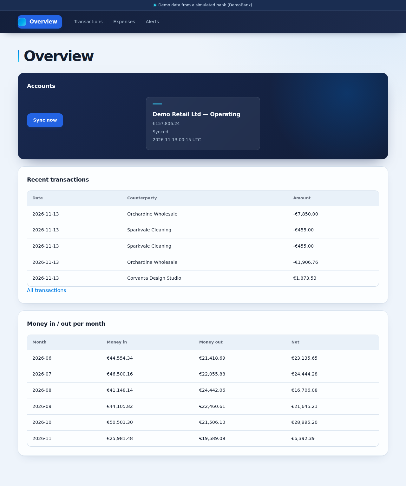
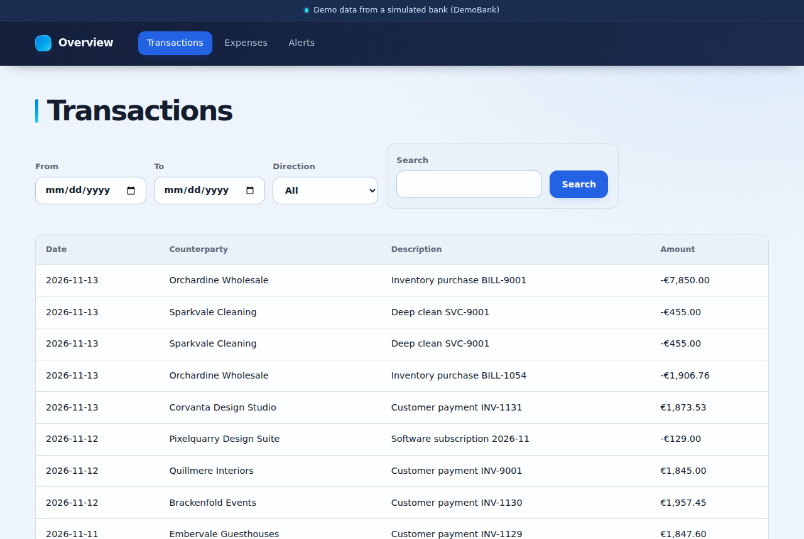
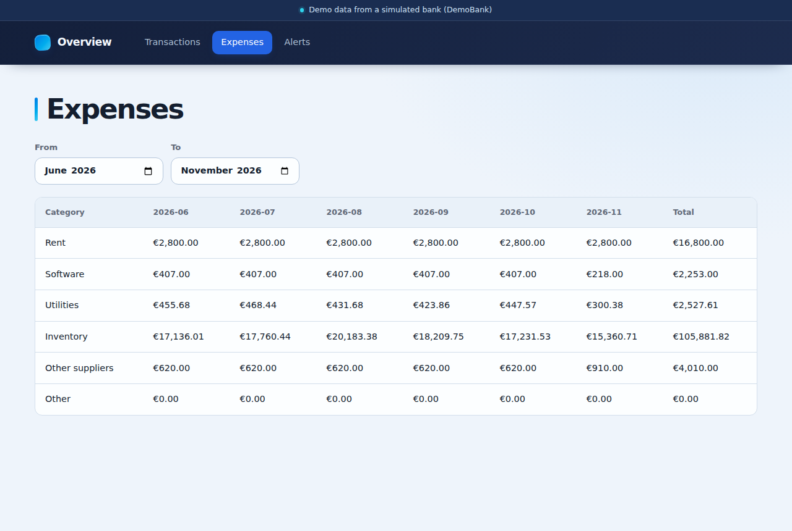
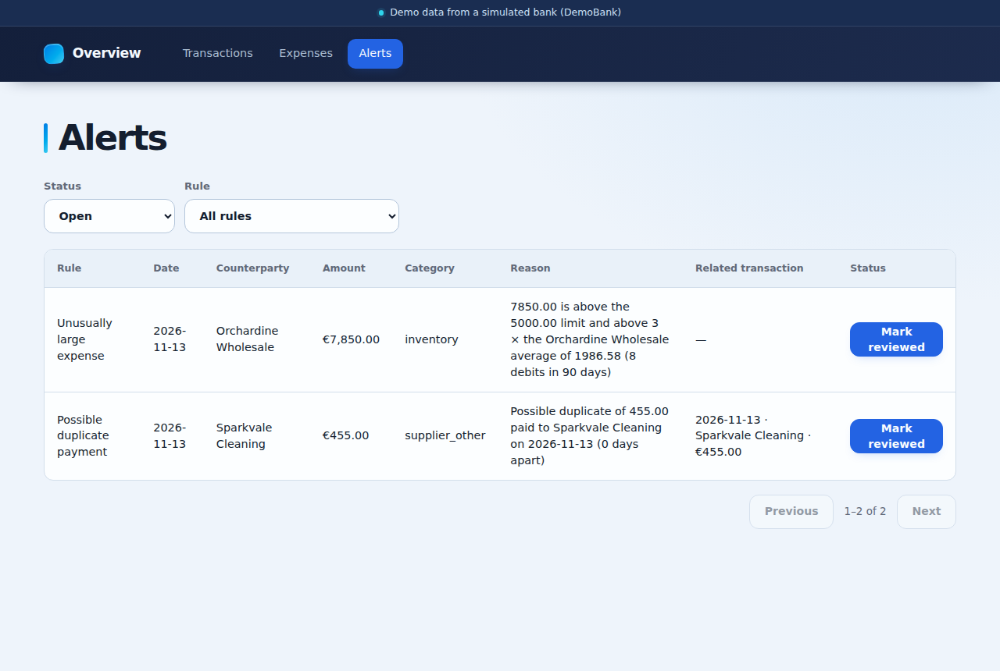

# LedgerLens

LedgerLens turns a small business's bank transactions into answers to two
everyday questions: *where is our money going?* and *is anything wrong
with our payments?*

## The problem

A small business (for example a shop) pays rent, suppliers, software and
utilities from one bank account, and customers pay into it. The owner sees
a long list of bank lines, but:

- **Spending is hard to see.** The bank shows individual transactions, not
  how much went to rent, stock or software this month, or how that changes
  over time. Building that view by hand in a spreadsheet takes time every
  month.
- **Payment mistakes go unnoticed.** A supplier paid twice, or an expense
  far larger than usual, is easy to miss in a long list. By the time
  someone notices, the money is gone and is harder to recover.

## How LedgerLens solves it

LedgerLens connects to the bank, keeps its own copy of the transactions
and analyses them automatically:

1. **Sync:** one click on **Sync now** fetches the accounts and
   transactions from the bank and stores them. Syncing again only adds
   what is new; nothing is stored twice.
2. **Spending by category:** every transaction is put in a category
   (rent, software, utilities, inventory, other suppliers, revenue,
   other). The Overview shows the balance and money in and out per month;
   the Expenses page shows spending per category and month.
3. **Anomaly detection:** after every sync two rules look for potential
   issues and list them on the Alerts page for a person to review:
   - **possible duplicate payment:** a second payment to the same payee,
     within 3 days, for about the same amount (within 1%)
   - **unusually large expense:** a payment above 5,000.00, or more than
     3 times the usual amount for that payee or category

   A flag is a potential issue for a person to check, never a finding of
   fraud. The person marks it as reviewed once checked.

**Expected behaviour in the demo:** the bank is DemoBank, a simulated bank
with fictional data (no real bank is connected). After the first sync,
LedgerLens shows about six months of transactions (around 240), the
account balance, monthly spending per category, and exactly 2 flags: a duplicate payment to
Sparkvale Cleaning (2 × €455.00) and an unusually large purchase from
Orchardine Wholesale (€7,850.00). A second sync adds nothing.

See [`docs/scope.md`](docs/scope.md) for what is built. The backend lives
in `backend/`, the simulated bank DemoBank in `demobank/`, the frontend in
`frontend/`, and the design docs in `docs/`.

## Screenshots

Taken after one sync from DemoBank.

**Overview:** the account balance, the last sync, recent transactions and
money in and out per month.



**Transactions:** every synced transaction, filtered by date, direction
and text.



**Expenses:** spending per category and month.



**Alerts:** the two flags (an unusually large expense and a possible
duplicate payment), with the reason for each, ready to mark as reviewed.



## Quick start

Prerequisite: Docker with Compose v2.

From the repo root:

```sh
cp .env.example .env     # demo values; .env is ignored by git
docker compose up --build
```

This starts 4 services:

| Service | What it is | URL |
| --- | --- | --- |
| `frontend` | the UI (Vite dev server) | http://localhost:5173 |
| `backend` | the API | http://localhost:8000/docs (API docs), http://localhost:8000/api/health |
| `demobank` | a simulated bank with fictional data | http://localhost:8100/docs (API docs), http://localhost:8100/health |
| `db` | PostgreSQL | localhost:5432 |

Open the app at http://localhost:5173. The backend and DemoBank are APIs
without a home page, so their bare addresses (`/`) answer
`{"detail":"Not Found"}`; use the links above.

`frontend` starts once the backend is healthy. The browser talks only to
port 5173: the dev server forwards `/api/...` to the backend.

When the backend container starts, it checks its configuration, applies the
database migrations (`alembic upgrade head`) and then serves the API. It
does not start when the configuration is invalid or a migration cannot run.

## Demo walkthrough

Open http://localhost:5173, then:

1. **Sync now** on the Overview: fetches DemoBank's accounts and
   transactions, categorizes them and runs the anomaly rules
2. Overview: account balances, money in and out per month, and the recent
   transactions
3. Transactions: every synced transaction, newest first, with a search
4. Expenses: spending per category and month
5. Alerts: the 2 planted flags, a possible duplicate payment and an
   unusually large expense
6. **Mark reviewed** on a flag: the flag is marked as reviewed

The 2 flags come from DemoBank, which plants one duplicate payment and one
unusually large expense at the end of its history (#12, see
[`demobank/README.md`](demobank/README.md) "Planted anomalies"). Syncing
again adds no duplicate transactions and no duplicate flags.

The data lives in a Docker volume, so `docker compose down` then
`docker compose up` keeps it. `docker compose down -v` followed by
`docker compose up --build` resets the data and the flags: DemoBank
generates a new history anchored on that day, and the next sync flags the
planted anomalies again.

## API

One line per route; `http://localhost:8000/docs` has the request and
response shapes.

- `GET /api/health` - the API and its database are up (200) or the
  database does not answer (503)
- `POST /api/sync` - sync every account from DemoBank, then run the
  anomaly rules
- `GET /api/accounts` - the synced accounts with their balances
- `GET /api/transactions` - the synced transactions, newest first
- `GET /api/categories` - the fixed category list
- `GET /api/reports/monthly?from=YYYY-MM&to=YYYY-MM` - money in, money out
  and net per month
- `GET /api/reports/expenses?from=YYYY-MM&to=YYYY-MM` - debits per expense
  category and month
- `GET /api/anomalies` - the potential issues flagged for review
- `POST /api/anomalies/{id}/review` - mark a flag as reviewed

A sync can also run from the command line, from `backend/` (it needs the
same settings as the API: `DATABASE_URL`, `DEMOBANK_API_KEY`, and
`DEMOBANK_BASE_URL` when DemoBank is not at `http://demobank:8100`):

```sh
uv run python -m ledgerlens.sync
```

## Project layout

- `backend/` - the LedgerLens API (FastAPI), see
  [`backend/README.md`](backend/README.md)
  - `ledgerlens/api/` - the HTTP routes
  - `ledgerlens/services/` - use cases, such as the sync
  - `ledgerlens/domain/` - pure rules: categories, anomaly rules, reports,
    money
  - `ledgerlens/db/` - SQLAlchemy models, repositories and the session
    (migrations in `migrations/`)
  - `ledgerlens/connectors/` - the bank connector for DemoBank
- `demobank/` - the simulated bank, see
  [`demobank/README.md`](demobank/README.md)
- `frontend/` - the UI (React, Vite)
- `docs/` - scope, accounting rules and process
- `docker-compose.yml` - the 4 local services
- `Makefile` - install, lint, type check, test and migrate
- `scripts/with-test-db.sh` - starts a throwaway PostgreSQL for `make test`
- `.github/workflows/` - CI

## Running the checks

Prerequisites: GNU make, [uv](https://docs.astral.sh/uv/), Node 22 and
Docker.

From the repo root:

```sh
make install   # uv sync in backend/ and demobank/, npm ci in frontend/
make test      # lint, format check, type check, unit and integration tests
```

`make test` runs everything with one command: the unit tests, and the
integration tests that run against a real PostgreSQL. It starts a
throwaway PostgreSQL container for them and removes it afterwards (or
uses `TEST_DATABASE_URL` if it is set). `make test-unit` runs the same
checks without a database, skipping the integration tests.

Run `make install` before `make test`, and again whenever the dependencies
change. `make test` stops at the first check that fails. `make help` lists
every target.

To apply the migrations to the Compose database by hand:

```sh
docker compose up -d db
make migrate     # DATABASE_URL, default: the Compose db
```

### Continuous integration

GitHub Actions (`.github/workflows/ci.yml`) runs the same checks on every
pull request and on every push to `main`: lint, type check, the unit and
integration tests of the backend and DemoBank (against a PostgreSQL
service), and the frontend tests and build. The results show on the pull
request and in the repository's **Actions** tab.

## Documents

- [`docs/scope.md`](docs/scope.md) - what is built
- [`docs/accounting-rules.md`](docs/accounting-rules.md) - the financial
  conventions, categories, anomaly rules and reports
- [`AGENTS.md`](AGENTS.md) - commands and rules for coding agents
- [`backend/README.md`](backend/README.md) - the backend, its database and
  migrations
- [`demobank/README.md`](demobank/README.md) - the simulated bank and its
  data
