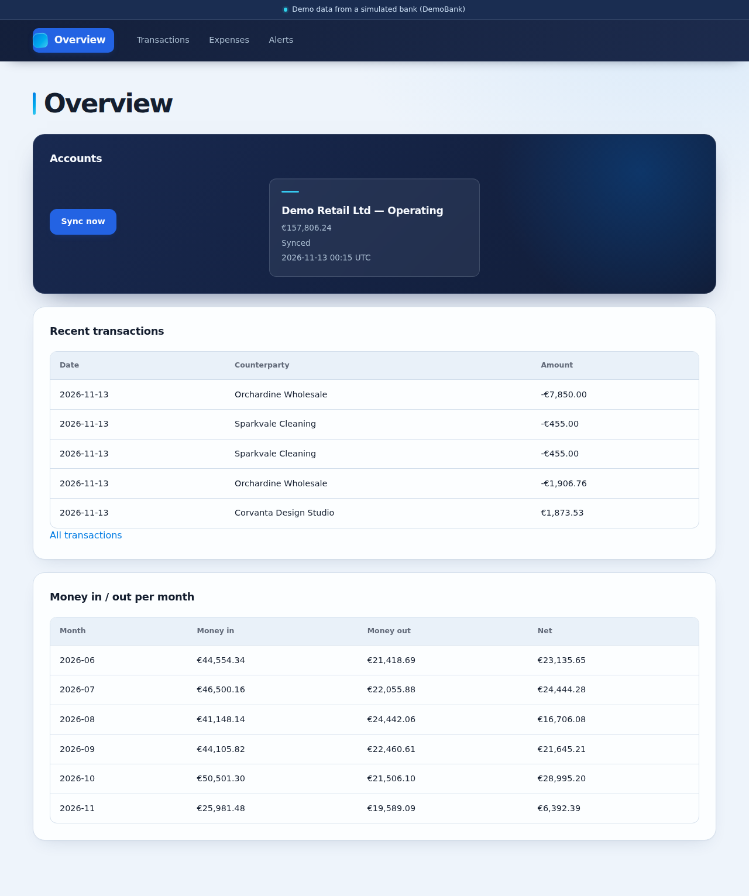
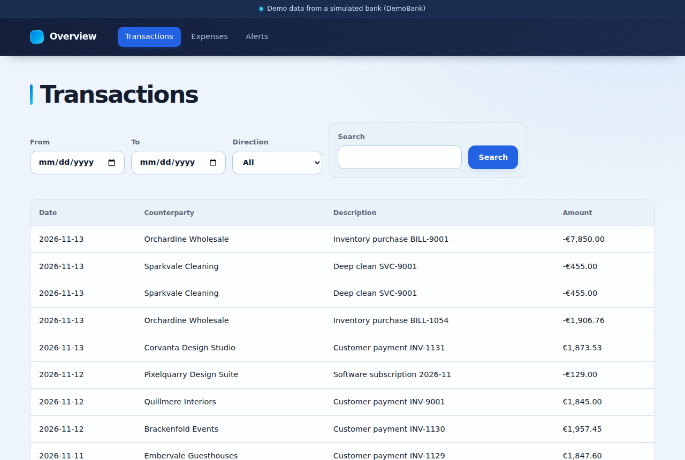
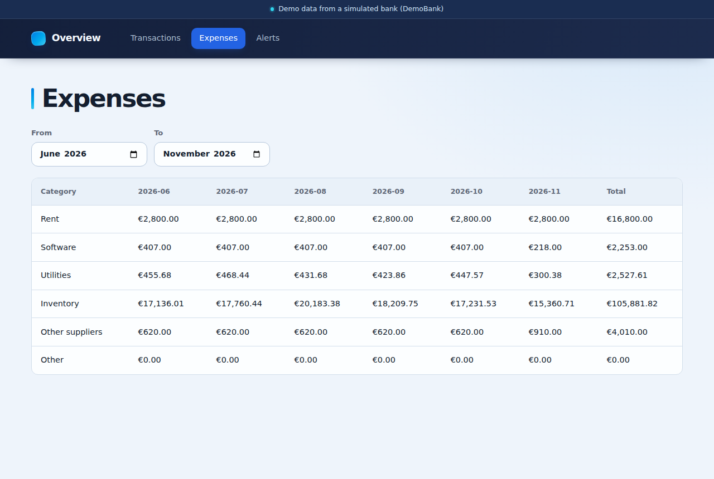
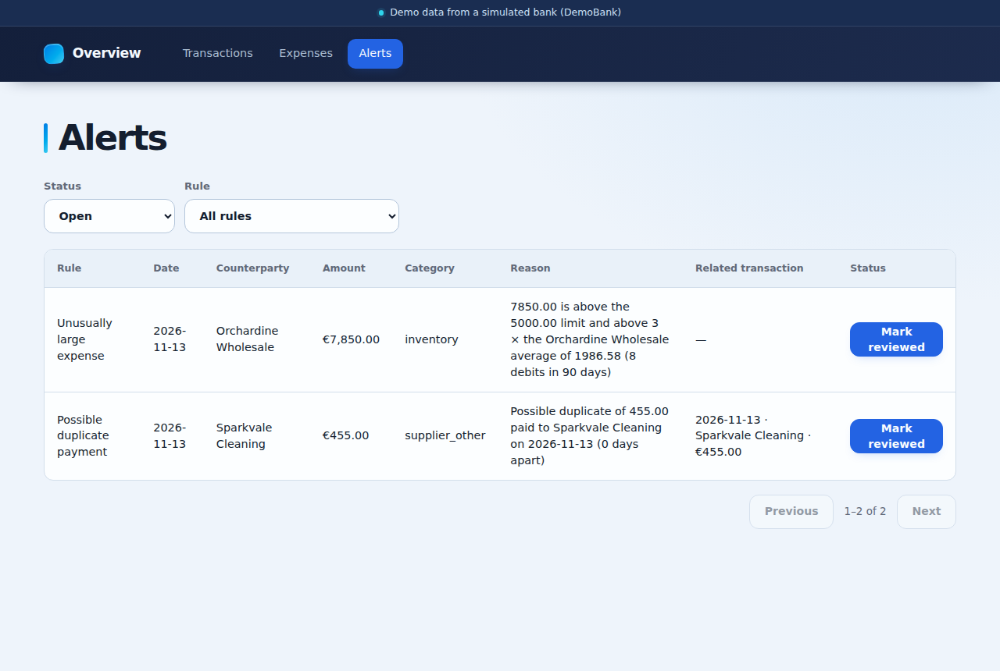

# Screenshots

The four pages of LedgerLens, taken from `docker compose up --build`
after one sync from DemoBank.

## Overview

The account balance, the last sync, recent transactions and money in and
out per month.

## Transactions

Every synced transaction, filtered by date, direction and text.

## Expenses

Spending per category and month.

## Alerts

The two flags (an unusually large expense and a possible duplicate
payment), with the reason for each, ready to mark as reviewed.

