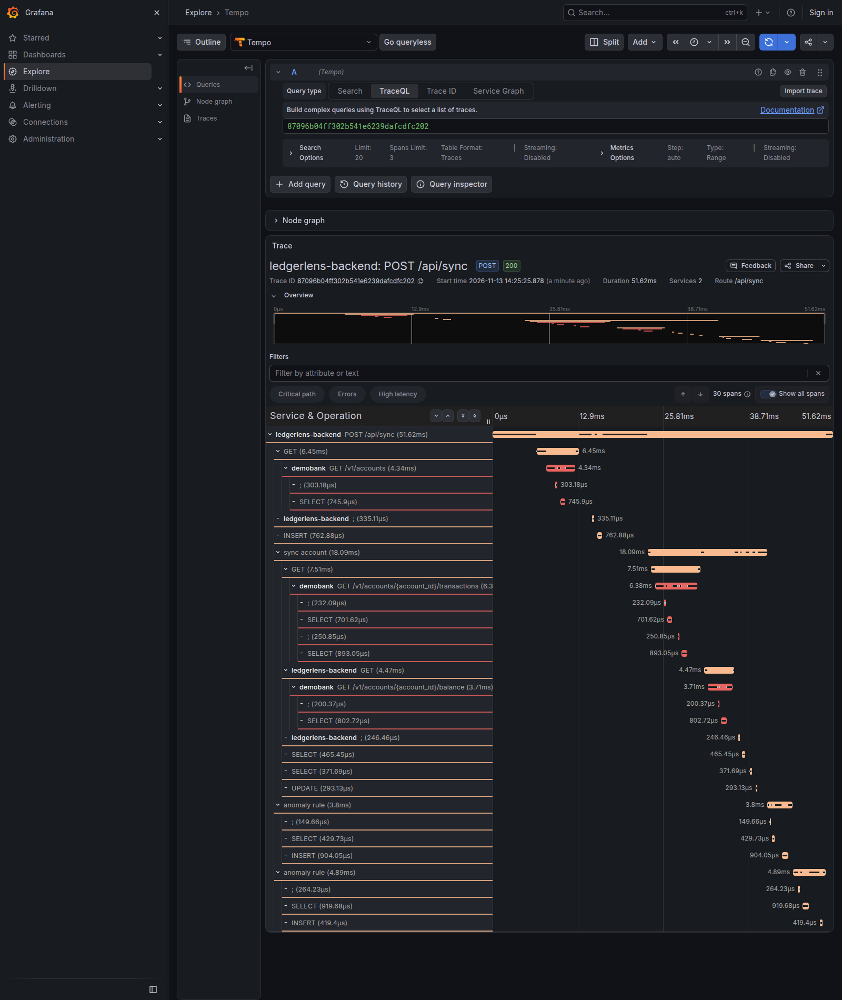
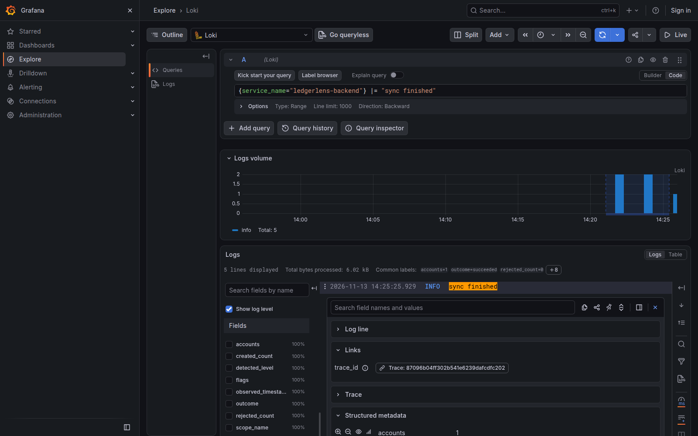
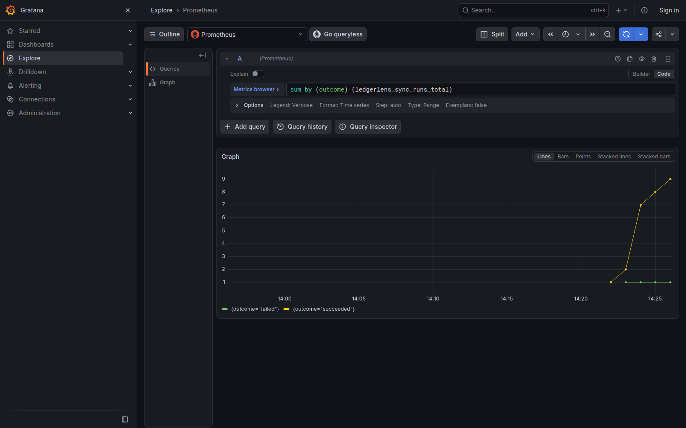

# Screenshots

The four pages of LedgerLens, taken from `docker compose up --build`
after one sync from DemoBank, then the same sync in Grafana.

## Overview

The account balance, the last sync, recent transactions and money in and
out per month.

## Transactions

Every synced transaction, filtered by date, direction and text.

## Expenses

Spending per category and month.

## Alerts

The two flags (an unusually large expense and a possible duplicate
payment), with the reason for each, ready to mark as reviewed.

## Observability

Taken from Grafana (http://localhost:3000, **Explore**) on the running
stack after a sync. The README section "Observability" lists the queries.

### A sync trace in Tempo

One `POST /api/sync` trace across `ledgerlens-backend` and `demobank`: the
DemoBank requests (`GET`) with DemoBank's server and DB spans under them,
the backend's DB spans, the `sync account` span and one `anomaly rule`
span per rule.

### A log line linked to its trace

The `sync finished` line in Loki, expanded: its fields are counts and the
outcome, and the **Trace** link under *Links* opens the trace above.

### Sync metrics in Prometheus

`sum by (outcome) (ledgerlens_sync_runs_total)`: the sync runs by outcome
(the `failed` run is a sync with DemoBank stopped).

